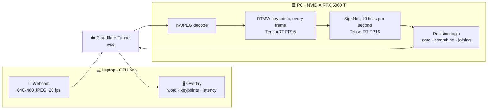

<div align="center">

# 🤟 The Almighty Sign Language

**Real-time American Sign Language recognition: webcam in, words out, in milliseconds.**

[](https://www.nvidia.com/)
[](https://developer.nvidia.com/cuda-toolkit)
[](https://developer.nvidia.com/tensorrt)
[](server/cpp)
[](training)
[](https://www.cloudflare.com/)
[](https://www.microsoft.com/windows/windows-11)

<sub>NVIDIA, CUDA, TensorRT and RTX are trademarks of NVIDIA Corporation; other names belong to their owners. This project is not affiliated with or endorsed by them.</sub>

</div>

---

A laptop webcam streams JPEG frames over a Cloudflare Tunnel to a PC with an RTX GPU. The PC finds the hands and upper body,
recognises the sign and sends the result back, and the laptop shows it large on the video. The laptop needs no GPU.

| 🗣️ Vocabulary | 💬 Sentences (joined from words within 1.5 s) |
|---|---|
| **hello · what · how · why · where · you** (plus `none`) | **how are you?** = HOW then YOU<br>**where are you?** = WHERE then YOU, or YOU then WHERE |

## ⚡ How it works



The C++/CUDA server is the primary. A Python fallback server speaks the same protocol with the same models (ONNX Runtime) and
can take over in about 9 seconds.

## 📊 Measured, not promised

Every number below comes with its command in [docs/RESULTS.md](docs/RESULTS.md) and [governance/STATUS.md](governance/STATUS.md).

| | |
|---|---|
| ⏱️ **Server time per frame** | about **5 ms** median (C++/TensorRT FP16); the Python fallback needs about 22 ms |
| 🛡️ **Soak test through the tunnel** | 4,521 of 4,521 frames answered in 10 minutes, no errors, no reconnects, no memory growth |
| 🧪 **Tests** | C++ 61 CPU + 6 GPU, Python 44 (decision + recognition clock), protocol conformance 9/9 on both servers, AddressSanitizer clean |
| 🎯 **Accuracy on 11 unseen signers** | 84.8% of windows correct (macro-F1 0.83) with the primary keypoint model; the per-word table and the weak spots (`where`, `you`, sentences) are listed honestly in RESULTS |

## 📚 Documents

- Protocol: [protocol/PROTOCOL.md](protocol/PROTOCOL.md) · Design spec: [governance/BUILD_SPEC.md](governance/BUILD_SPEC.md) · Progress: [governance/STATUS.md](governance/STATUS.md) · Choices: [governance/DECISIONS.md](governance/DECISIONS.md)
- Measured results (every number with its command): [docs/RESULTS.md](docs/RESULTS.md)
- Demo day: [docs/DEMO_CHECKLIST.md](docs/DEMO_CHECKLIST.md) · Live check on the laptop: [docs/LAPTOP_LIVE_TEST.md](docs/LAPTOP_LIVE_TEST.md) · Debugging a word that does not appear: [docs/DIAG_YOU.md](docs/DIAG_YOU.md)

## 🔒 Data and licence

Recognition models are trained on **ASL Citizen** (Microsoft Research licence: non-commercial research use only). The data
and the trained weights stay on the author's PC: `data/`, `server/models/` and `training/runs/` are gitignored. Never commit,
share or upload them.

## 🟩 Set up the PC (Windows 11, NVIDIA RTX 50-series, CUDA 13.2)

Everything lives in `C:\dev\almighty-sign-language` (no spaces in the path). Commands are PowerShell, run from the repo root.

1. **Tools** (already installed on the demo PC): Visual Studio 2022 (C++ workload), CUDA 13.2, CMake + Ninja (from VS), TensorRT 10.16 unzipped to `C:\dev\TensorRT-10.16.1.11`, vcpkg in `C:\dev\vcpkg`, Python 3.11.
2. **Python environments:** `python -m venv training\.venv` then `training\.venv\Scripts\pip install -r training\requirements.txt`; `python -m venv client\.venv` then `client\.venv\Scripts\pip install -r client\requirements.txt`.
3. **Models** (not in git; weights are local-only). `server\models\` must hold `rtmw_x_384x288.onnx`, `rtmw_l_m_256x192.onnx`, `temporal_primary.onnx`, `temporal_fallback.onnx` (the temporal ONNX files and `.engine` files come from `training\export_onnx.py`). Then build the keypoint engines: `powershell -File server\scripts\build_engines.ps1`.
4. **Secret:** `setx SIGNLANG_TOKEN <long random value>`, then open a NEW terminal. It is the only place the token lives; never put it in a file or a chat.
5. **Build:** `powershell -File server\scripts\build_cpp.ps1` (first build takes a few minutes).
6. **Check everything:** `powershell -File server\scripts\run_tests.ps1` (C++ tests, Python decision tests, conformance against a throw-away server).
7. **Run:** `powershell -File server\scripts\switch_server.ps1 -To cpp`. The Cloudflare tunnel runs as the Windows service `cloudflared` and forwards `wss://signlang.dheynorlanda.me/ws` to `http://localhost:8765`; do not touch its configuration.

Servers: `switch_server.ps1 -To cpp | safe | python | stop | status` (one at a time owns port 8765; `safe` = C++ server on the small keypoint model; `python` = the Python fallback). Add `-Diag` to also write a numbers-only per-frame log (see [docs/DIAG_YOU.md](docs/DIAG_YOU.md)).

## 💻 Set up the laptop (no GPU needed)

See [LAPTOP_SETUP.md](LAPTOP_SETUP.md), then [docs/LAPTOP_LIVE_TEST.md](docs/LAPTOP_LIVE_TEST.md). In short: install Python 3.11+, `git clone` (or `git fetch` + `git reset --hard origin/main` for an existing clone), create `client\.venv` with `pip install -r client\requirements.txt`, set `SIGNLANG_TOKEN` with `setx` (the same value as on the PC) and run

```
client\.venv\Scripts\python client\client.py
```

Keys in the window: **k** show/hide the detected hand and body keypoints, **d** more details, **q** or Esc quit. The latency (round trip and server time) is shown bottom right; the committed word or sentence appears large for 4 s.
Without a window (timing only): `client.py --headless --duration 30`.

## 🗂️ Repository map

| Folder | Content |
|---|---|
| `server/cpp` | C++/CUDA server (`src`, `kernels`, `tests`), built with CMake + vcpkg |
| `server/fallback` | Python fallback server and the reference decision logic |
| `server/scripts` | start, switch, build, test, sanitizer, soak, profiling and log-replay scripts |
| `server/config` | `server.json` (ports, models, thresholds, decision settings) |
| `client` | laptop client (CPU only) |
| `training` | keypoint extraction, SignNet training, ONNX/TensorRT export, evaluation |
| `protocol` | wire protocol, labels, conformance test |
| `governance`, `docs` | spec, status, decisions, results, checklists |
